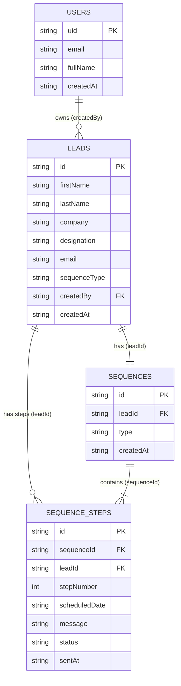

# 🚀 LeadFlow: Complete Project Architecture, Firebase Structure & Automation Blueprint

> **Detailed Technical Report & Architectural Reference**  
> *Generated for LeadFlow Platform Implementation*

---

## 📖 1. Executive Summary & Project Overview

**LeadFlow** is a modern, high-performance Sales Development Representative (SDR) automation and outreach platform designed to streamline B2B lead management and multi-channel follow-up sequences (LinkedIn & Email).

### Core Goals:
1. **Lead Management**: Capture, filter, search, and manage leads with owner-scoped access.
2. **Follow-Up Sequence Engine**: Map customized, multi-step outreach schedules for each lead.
3. **Outreach Execution**: Track step completion (`Pending`, `Sent`, `Skipped`) and trigger channel actions.
4. **Automation Core**: Provide background execution, scheduled triggers, and webhooks for zero-touch follow-up execution.

---

## 🏗️ 2. Full Codebase Architecture & File Structure

The project follows a clean **layered architecture** built on **Next.js App Router**, separating UI components, business services, and database repositories.

```
d:\LeadFlow\leadflow\
├── src/
│   ├── app/                         # Next.js App Router Pages & Routes
│   │   ├── (auth)/                  # Auth route group (login, register)
│   │   ├── (dashboard)/             # Dashboard layout & leads management
│   │   │   ├── dashboard/           # Summary stats & today's pending follow-ups
│   │   │   └── leads/               # Lead creation, listing, detail view
│   │   ├── globals.css              # Global styles & Tailwind CSS imports
│   │   ├── layout.tsx               # Root layout wrapper with AuthProvider
│   │   └── page.tsx                 # Root landing / redirect page
│   ├── components/                  # UI Components
│   │   ├── auth/                    # Auth forms & guarded layouts
│   │   ├── common/                  # Reusable icons & layout elements
│   │   ├── dashboard/               # Stats widgets & follow-up cards
│   │   ├── layout/                  # Sidebar, Navbar, Page Containers
│   │   ├── leads/                   # Lead forms, data tables, filter bars
│   │   ├── sequence/                # Sequence timeline & step status controls
│   │   └── ui/                      # Primitive UI components (Button, Badge, Input, Card)
│   ├── constants/                   # Constants (status colors, sequence defaults)
│   ├── context/                     # React Context (AuthContext for user state)
│   ├── hooks/                       # Custom React Hooks (useAuth, useLeads)
│   ├── lib/                         # External SDK Initialization
│   │   ├── firebase.ts              # Firebase App & Auth Singleton
│   │   ├── firestore.ts             # Firestore DB Singleton
│   │   └── utils.ts                 # Classname merge helpers (clsx/tailwind-merge)
│   ├── repositories/                # Low-level Data Access Layer (SDK interactions)
│   │   ├── auth.repository.ts       # Firebase Auth & User profile Firestore mutations
│   │   └── lead.repository.ts       # Raw Firestore queries for leads
│   ├── schemas/                     # Validation schemas (Zod validation for forms)
│   ├── services/                    # Business Logic & Workflow Service Layer
│   │   ├── auth.service.ts          # Auth state mapping & user creation workflow
│   │   ├── lead.service.ts          # Lead CRUD, atomic sequence creation, stats math
│   │   └── sequence.service.ts      # Batch sequence creation, step completion, chunking
│   ├── store/                       # Client state management
│   ├── types/                       # TypeScript Interface & Type Definitions
│   │   ├── api.ts                   # Generic API response contracts
│   │   ├── lead.ts                  # Lead, SequenceType, Filter & Stats interfaces
│   │   ├── sequence.ts              # Sequence, SequenceStep, StepStatus interfaces
│   │   └── user.ts                  # AuthUser & UserProfile interfaces
│   └── utils/                       # Utility functions (date formatters, outreach links, error handlers)
├── package.json
├── tsconfig.json
└── next.config.ts
```

### Architectural Key Patterns:
- **Repository Pattern**: `AuthRepository` & `LeadRepository` isolate direct Firebase SDK calls.
- **Service Layer**: `LeadService` & `SequenceService` implement transactional logic (e.g., creating a lead simultaneously creates sequence headers and steps via Firestore `writeBatch`).
- **Data Scoping**: Every lead and sequence step is bound to a `createdBy` or user `uid` key for strict multi-tenant privacy.

---

## 🗄️ 3. Firebase Architecture & Data Models

LeadFlow utilizes **Firebase Authentication** for identity management and **Cloud Firestore** for real-time document storage.

### A. Firebase Authentication
- **Provider**: Email & Password (`createUserWithEmailAndPassword`, `signInWithEmailAndPassword`).
- **User Token**: Firebase JWT, observed via `onAuthStateChanged`.
- **User Profile Creation**: Automatically provisions a corresponding document in the `users` collection upon registration.

---

### B. Firestore Collections & Schema Definitions

#### 1. `users` Collection
Stores user profiles and metadata.
* **Document ID**: `{uid}` (Matches Firebase Auth UID)

| Field Name | Type | Description |
| :--- | :--- | :--- |
| `uid` | `string` | Unique Firebase Auth user ID |
| `email` | `string` | User's registered email address |
| `fullName` | `string` | SDR Full Name |
| `createdAt` | `string` (ISO 8601) | Timestamp of user creation |

---

#### 2. `leads` Collection
Stores individual lead records managed by SDRs.
* **Document ID**: Auto-generated string (`doc(collection(db, 'leads')).id`)

| Field Name | Type | Options / Rules | Description |
| :--- | :--- | :--- | :--- |
| `id` | `string` | Primary Key | Document ID |
| `firstName` | `string` | Required | Lead's first name |
| `lastName` | `string` | Required | Lead's last name |
| `company` | `string` | Required | Target organization |
| `designation` | `string` | Required | Job title / Role |
| `email` | `string` | Required | Target email address |
| `phone` | `string` | Optional | Phone number |
| `linkedin` | `string` | Optional | LinkedIn profile URL |
| `notes` | `string` | Optional | Strategic notes |
| `sequenceType`| `string` | `'linkedin' \| 'email'` | Active campaign type |
| `createdBy` | `string` | Required | Owner User UID |
| `createdAt` | `string` (ISO 8601) | Required | Creation timestamp |
| `updatedAt` | `string` (ISO 8601) | Required | Modification timestamp |

---

#### 3. `sequences` Collection
Header document linking a lead to its active outreach campaign.
* **Document ID**: Auto-generated string (`doc(collection(db, 'sequences')).id`)

| Field Name | Type | Description |
| :--- | :--- | :--- |
| `id` | `string` | Primary Key |
| `leadId` | `string` | Foreign Key -> `leads.id` |
| `type` | `string` (`'linkedin' \| 'email'`) | Type of outreach campaign |
| `createdAt` | `string` (ISO 8601) | Timestamp of sequence initialization |
| `updatedAt` | `string` (ISO 8601) | Timestamp of last update |

---

#### 4. `sequenceSteps` Collection
Individual scheduled outreach tasks within a sequence.
* **Document ID**: Auto-generated string (`doc(collection(db, 'sequenceSteps')).id`)

| Field Name | Type | Options / Values | Description |
| :--- | :--- | :--- | :--- |
| `id` | `string` | Primary Key | Step ID |
| `sequenceId` | `string` | Foreign Key -> `sequences.id` | Associated sequence header ID |
| `leadId` | `string` | Foreign Key -> `leads.id` | Denormalized lead link for fast queries |
| `stepNumber` | `number` | `1, 2, 3...` | Sequence position |
| `scheduledDate`| `string` | `YYYY-MM-DD` / ISO | Target execution date |
| `message` | `string` | Required | Email body or LinkedIn message text |
| `subject` | `string` | Optional | Email Subject line |
| `status` | `string` | `'Pending' \| 'Sent' \| 'Skipped'` | Execution status |
| `sentAt` | `string` | Optional (ISO 8601) | Timestamp when marked sent |
| `createdAt` | `string` | (ISO 8601) | Record creation timestamp |
| `updatedAt` | `string` | (ISO 8601) | Record update timestamp |

---

### C. Entity Relationship Diagram (ERD)



---

### D. Production Firestore Security Rules (`firestore.rules`)

To enforce secure multi-tenant isolation, deploy the following production rules:

```javascript
rules_version = '2';
service cloud.firestore {
  match /databases/{database}/documents {
    
    // Helper functions
    function isAuthenticated() {
      return request.auth != null;
    }
    
    function isOwner(userId) {
      return isAuthenticated() && request.auth.uid == userId;
    }
    
    function isLeadOwner(leadId) {
      return isAuthenticated() && 
        get(/databases/$(database)/documents/leads/$(leadId)).data.createdBy == request.auth.uid;
    }

    // User Profile Document Rules
    match /users/{userId} {
      allow read, write: if isOwner(userId);
    }

    // Leads Rules
    match /leads/{leadId} {
      allow create: if isAuthenticated() && request.resource.data.createdBy == request.auth.uid;
      allow read, update, delete: if isAuthenticated() && resource.data.createdBy == request.auth.uid;
    }

    // Sequences Rules
    match /sequences/{sequenceId} {
      allow create: if isAuthenticated() && isLeadOwner(request.resource.data.leadId);
      allow read, update, delete: if isAuthenticated() && isLeadOwner(resource.data.leadId);
    }

    // Sequence Steps Rules
    match /sequenceSteps/{stepId} {
      allow create: if isAuthenticated() && isLeadOwner(request.resource.data.leadId);
      allow read, update, delete: if isAuthenticated() && isLeadOwner(resource.data.leadId);
    }
  }
}
```

---

## ⚡ 4. Automation Architecture & Engine Blueprint

Currently, LeadFlow provides semi-automated outreach actions (e.g., clicking "Mark Sent" or launching custom Gmail/LinkedIn URL shortcuts). To upgrade to **100% Automated Execution**, the platform needs an **Automated Sequence Dispatcher Engine**.

### High-Level Automation Architecture

```
                       +-----------------------------------+
                       |      Firebase Cloud Functions     |
                       |       (Scheduled Pub/Sub Cron)    |
                       +-----------------+-----------------+
                                         |
                                         | 1. Every hour trigger
                                         v
                       +-----------------+-----------------+
                       |   Query Overdue/Today Steps      |
                       |   status == 'Pending'             |
                       |   scheduledDate <= TODAY          |
                       +-----------------+-----------------+
                                         |
                                         | 2. Fetch Lead Data & Hydrate Templates
                                         v
                        +----------------+----------------+
                        |                                 |
         (Email Sequence) |                                 | (LinkedIn Sequence)
                        v                                 v
          +-------------+-------------+     +-------------+-------------+
          | Transactional Email Provider|     |  LinkedIn Outreach Service  |
          | (SendGrid / Resend API)     |     | (Unipile / Custom Webhook)  |
          +-------------+-------------+     +-------------+-------------+
                        |                                 |
                        +----------------+----------------+
                                         |
                                         | 3. Update Firestore via Admin SDK
                                         v
                       +-----------------+-----------------+
                       | Update sequenceStep:              |
                       | - status = 'Sent'                 |
                       | - sentAt = timestamp              |
                       +-----------------------------------+
```

---

## 🛠️ 5. Step-by-Step Implementation Guide for Automation

### Step 1: Firebase Cloud Functions Environment Setup

Initialize Firebase Functions (Node.js 20+ with TypeScript) inside your project workspace:

```bash
npx firebase-tools init functions
```

### Step 2: Implement Scheduled Cron Dispatcher (`functions/src/index.ts`)

Use **Firebase Cloud Functions v2** (`onSchedule`) to run periodic background dispatchers:

```typescript
import { onSchedule } from 'firebase-functions/v2/scheduler';
import { initializeApp } from 'firebase-admin/app';
import { getFirestore, FieldValue } from 'firebase-admin/firestore';
import nodemailer from 'nodemailer'; // or @sendgrid/mail / resend SDK

initializeApp();
const db = getFirestore();

// SMTP / Email Provider Setup
const transporter = nodemailer.createTransport({
  host: process.env.SMTP_HOST,
  port: Number(process.env.SMTP_PORT),
  auth: {
    user: process.env.SMTP_USER,
    pass: process.env.SMTP_PASS,
  },
});

export const processScheduledFollowups = onSchedule(
  {
    schedule: 'every 1 hours',
    timeZone: 'UTC',
    retryCount: 3,
  },
  async (event) => {
    const today = new Date().toISOString().split('T')[0];

    // 1. Fetch pending sequence steps scheduled today or earlier
    const pendingStepsSnap = await db
      .collection('sequenceSteps')
      .where('status', '==', 'Pending')
      .where('scheduledDate', '<=', today)
      .limit(100) // Batch execution size
      .get();

    if (pendingStepsSnap.empty) {
      console.log('No pending follow-ups to process.');
      return;
    }

    console.log(`Processing ${pendingStepsSnap.size} pending steps...`);

    for (const stepDoc of pendingStepsSnap.docs) {
      const stepData = stepDoc.data();
      const { leadId, sequenceId, message, subject } = stepData;

      try {
        // 2. Fetch Lead metadata
        const leadDoc = await db.collection('leads').doc(leadId).get();
        if (!leadDoc.exists) {
          console.warn(`Lead ${leadId} not found. Skipping.`);
          continue;
        }

        const lead = leadDoc.data()!;

        // 3. Channel Execution Branching
        if (lead.sequenceType === 'email') {
          // Process Email Dispatch
          await transporter.sendMail({
            from: '"Sales Team" <outreach@leadflow.io>',
            to: lead.email,
            subject: subject || `Follow-up for ${lead.firstName}`,
            text: message, // Can also parse template tags e.g. {{firstName}}
          });
        } else if (lead.sequenceType === 'linkedin') {
          // Trigger LinkedIn Automation via Webhook (e.g. Unipile / Make.com)
          /*
          await fetch('https://api.unipile.com/v1/users/invite', {
            method: 'POST',
            headers: { 'Authorization': `Bearer ${process.env.UNIPILE_API_KEY}` },
            body: JSON.stringify({ recipient_url: lead.linkedin, text: message })
          });
          */
        }

        // 4. Mark Step as Sent
        await stepDoc.ref.update({
          status: 'Sent',
          sentAt: new Date().toISOString(),
          updatedAt: new Date().toISOString(),
        });

      } catch (err: any) {
        console.error(`Failed step ${stepDoc.id}:`, err);
        // Optional: Update step with failure metadata or increment retry counter
      }
    }
  }
);
```

---

### Step 3: Webhook Endpoint for Engagement Tracking (`/api/webhooks/email`)

Track email opens, clicks, or replies by deploying an Next.js API route or HTTP Function:

```typescript
// src/app/api/webhooks/email/route.ts
import { NextResponse } from 'next/server';
import { db } from '@/lib/firestore';
import { doc, updateDoc } from 'firebase/firestore';

export async function POST(req: Request) {
  try {
    const payload = await req.json();
    const { event, stepId, leadId } = payload;

    if (event === 'reply_received') {
      // Pause sequence or mark follow-up completed
      const stepRef = doc(db, 'sequenceSteps', stepId);
      await updateDoc(stepRef, {
        status: 'Sent',
        sentAt: new Date().toISOString(),
      });
    }

    return NextResponse.json({ success: true });
  } catch (error: any) {
    return NextResponse.json({ error: error.message }, { status: 500 });
  }
}
```

---

## 📊 6. Summary of Architectural Features & Best Practices

1. **Repository & Service Pattern**: Keeps Next.js UI component logic clean and facilitates testability.
2. **Batch Operations**: Uses `writeBatch` when creating Leads & Sequence Steps to guarantee database integrity.
3. **Query Optimization**: Implements in-memory filtering and query chunking (splitting into batches of 30) to comply with Firestore `in` query limits.
4. **Security & Data Privacy**: Full Firestore Security Rules ensure multi-tenant SDR data isolation.
5. **Seamless Automation Readiness**: Cloud Functions v2 and Webhooks allow background job handling without blocking front-end UI performance.

---
*Report stored at: `LEADFLOW_FIREBASE_AUTOMATION_REPORT.md`*
